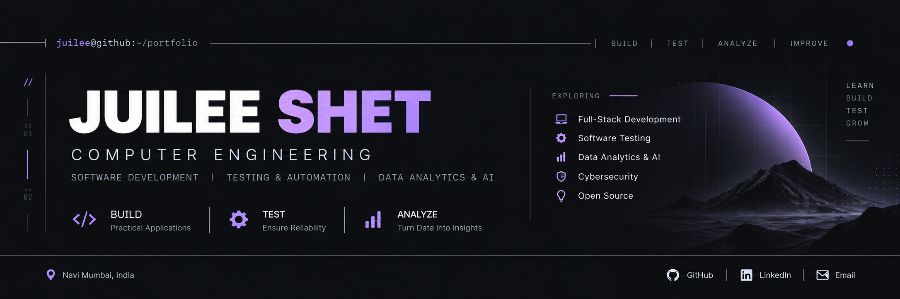

# Juilee Shet

<p align="center">
  
</p>

<p align="center">
  <b>Computer Engineering Undergraduate | Software Quality | Data Analytics</b>
</p>

<p align="center">
  <a href="https://github.com/juileeshet">
    
  </a>
  <a href="https://www.linkedin.com/in/juilee-shet">
    
  </a>
</p>

```text
juilee@github:~/portfolio

$ whoami
Computer Engineering | RAIT

$ interests
Software Quality Assurance | Data Analytics | Software Engineering

$ current_focus
Testing | API Validation | Data Quality | Automation

$ workflow
build() -> test() -> analyze() -> improve()
```

## ~/about_me

I'm a Computer Engineering undergraduate at D. Y. Patil Ramrao Adik Institute of Technology, interested in building reliable software, ensuring application quality, and transforming data into meaningful insights.

- Former Software Engineering Intern at **Akasa Air**, contributing to enterprise aviation software.
- Interested in Software Testing & Automation, Data Analytics, and Data Quality Engineering.
- Experience working with frontend technologies, REST APIs, databases, and machine learning.
- Enjoy exploring application behaviour, identifying issues, debugging, and improving software reliability.

**My approach:** Write reliable code, validate functionality, investigate problems, and continuously improve.

## ~/tech_stack

### Programming Languages

<p>
  
  
  
  
  
  
</p>

### Software Engineering & Frontend

<p>
  
  
  
  
  
</p>

### Backend, APIs & Databases

<p>
  
  
  
  
  
</p>

### Software Testing & Quality Assurance

<p>
  
  
  
  
  
</p>

### Data Analytics & Machine Learning

<p>
  
  
  
  
  
</p>

### Developer Tools & Design

<p>
  
  
  
  
</p>

### Additional Technical Exposure

<p>
  
  
  
  
</p>

## ~/featured_projects

### 01 | Lumina Insights

**Data Analytics & Visualization**

A data analytics project focused on processing datasets, identifying meaningful patterns, and translating analytical findings into actionable insights.

- Data processing and exploration.
- Analytical insights and visualization.
- Data-driven interpretation.

**Focus:** Python | Data Analytics | Visualization

[View Repository →](https://github.com/juileeshet/lumina-insights)

### 02 | AeroNexus

**Airport Management System**

A full-stack airport management and flight booking application designed to streamline airport operations through role-based dashboards and integrated management features.

- Role-based dashboards and access management.
- Flight operations and booking management.
- Interactive seat selection.
- Administrative analytics.

**Tech Stack:** Python | Flask | SQLite | HTML | CSS | JavaScript | Leaflet

[View Repository →](https://github.com/juileeshet/AeroNexus)

### 03 | WebShield AI

**Machine Learning | Phishing Website Detection**

A machine-learning-based system designed to identify potentially malicious URLs and classify websites based on phishing risk.

- Machine learning models using Logistic Regression and Random Forest.
- URL feature extraction and classification.
- Risk classification and REST API integration.
- Interactive frontend dashboard.

**Reported Model Accuracy:** 93.18%

**Tech Stack:** Python | FastAPI | Scikit-learn | React | Vite | SQLite

[View Repository →]([https://github.com/juileeshet](https://github.com/juileeshet/WebShield-AI))

<p align="center">
  <a href="https://github.com/juileeshet?tab=repositories">
    
  </a>
</p>

## ~/experience.log

### Software Engineering Intern | Akasa Air

**June 2026 – August 2026**

- Contributed to the development and maintenance of features for an enterprise aviation application.
- Worked with React, React Native, TypeScript, JavaScript, NestJS, MySQL, and Git.
- Assisted with API integration, application validation, debugging, and troubleshooting.
- Participated in testing and improving application functionality and reliability.

## ~/certifications_and_learning

- CompTIA Security+ (SY0-701)
- Google AI Essentials
- CS50: Introduction to Programming with Python
- Learning Java 11
- Power BI for Beginners

## ~/github_stats

<p align="center">
  
  
</p>

<p align="center">
  
</p>

## ~/connect

<p align="center">
  <a href="https://github.com/juileeshet">
    
  </a>
  <a href="https://www.linkedin.com/in/juilee-shet">
    
  </a>
</p>

<p align="center">
  <i>Build with purpose. Test with precision. Turn data into insights.</i>
</p>
